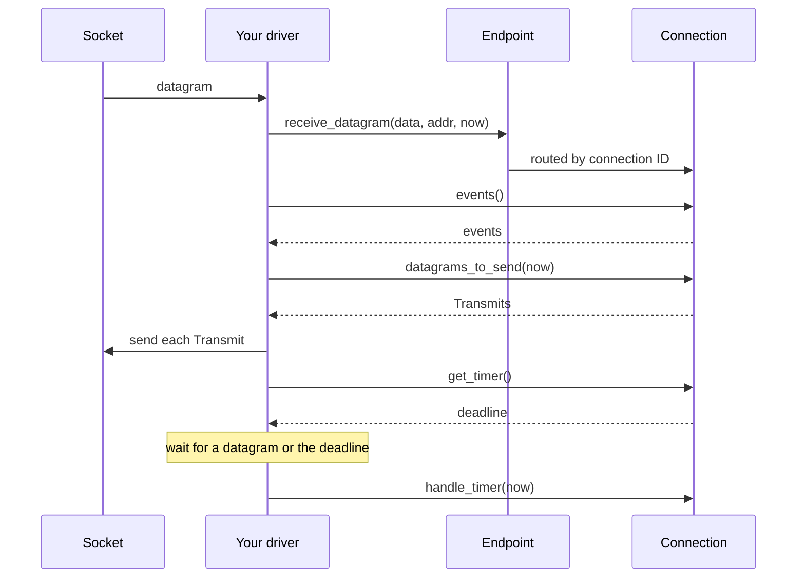

# Understand the sans-I/O model

By the end of this tutorial you will have a small driver that does the jobs
ngquic leaves to your program: it carries datagrams, reads events and runs
timers for two endpoints. It runs on a virtual clock that jumps straight to
the next timer, so you can watch a connection open, echo a stream, close, and
release its state in an instant.

## Before you start

- Complete [Your first handshake](first-handshake.md). This tutorial works in
  the same `quic-tour` directory and imports its `localhost_certs.py`, from
  [Get a test certificate](first-handshake.md#get-a-test-certificate).

## Run the driver

Save this program as `protocol_model.py` in `quic-tour`, next to
`localhost_certs.py`:

```python title="protocol_model.py"
--8<-- "examples/protocol_model.py"
```

Run it:

```console
python protocol_model.py
```

It prints:

```text
client HandshakeCompleted
client StreamsAvailable
server HandshakeCompleted
server HandshakeConfirmed
server StreamsAvailable
server StreamDataReceived
client HandshakeConfirmed
client NewTokenReceived
client SessionTicketReceived
client SessionTicketReceived
client StreamDataReceived
client StreamClosed
client ConnectionTerminated
server ConnectionTerminated
client CLOSED, server CLOSED 3 PTOs after close()
endpoints hold 0
```

The program prints every event, including the many it does not act on. The
next section describes the interface the driver uses; the three after it
explain the driver in parts, with code copied from `protocol_model.py`, so
there is nothing more to type.

## Three inputs, three outputs

Everything that reaches ngquic is a method call, and everything that leaves it
is a return value:

| Your program passes in | ngquic hands back |
| --- | --- |
| a received UDP payload: `Endpoint.receive_datagram(data, remote_addr, now)` | payloads to send: `Transmit` objects from `datagrams_to_send()` |
| the time a timer was due: `handle_timer(now)` | the next deadline: `get_timer()` |
| application actions: `open_stream()`, `send_stream_data()`, `close()` | what happened: `events()` |

Every call that can start or run a timer takes `now`: monotonic seconds as a
`float`, on whichever clock your program uses. ngquic only compares the
values you give it, which is why this example can start its clock at `0.0`
and move it by hand.

One round of a driver looks like this:



## Send what is queued

```python
--8<-- "examples/protocol_model.py:network"
```

`flush()` collects two kinds of output. `Endpoint.datagrams_to_send()` returns
stateless replies that belong to no connection: Version Negotiation, Retry,
refusals and stateless resets. `Connection.datagrams_to_send(now)` returns a
connection's own packets. Call both after every input, because any input can
queue output.

Each `Transmit` names its destination in `remote_addr` and its source in
`local_addr`. This lossless link uses those addresses to find the receiving
endpoint and to say where the datagram came from.

`Endpoint.receive_datagram()` returns one of three things: the connection that
took the datagram, an `Incoming` for a new connection attempt, or `None` when
the datagram was dropped or answered statelessly. A server decides each
`Incoming` once: `accept()`, `retry()` to make the client prove its address
first ([RFC 9000 §8.1](https://www.rfc-editor.org/rfc/rfc9000#section-8.1)),
`refuse()` or `ignore()`. `accept()` can return `None` when the attempt is
dropped or needs address validation, so the driver checks.

`wait()` asks each connection for `get_timer()`. `None` means the connection
needs no timer; otherwise it is the time, on your clock, at which
`handle_timer()` must run. A real driver sleeps until that moment or until a
datagram arrives, whichever is first. This one jumps the clock forward
instead, so the example runs instantly and prints the same output on every run.

## React to events

```python
--8<-- "examples/protocol_model.py:run"
```

The loop flushes, drains every connection's `events()`, and waits for a timer
only when no datagram moved. The application acts on three events:

- `HandshakeCompleted` on the client opens a stream and sends `b"ping"`.
- `StreamDataReceived` on the server echoes the data back on the same stream.
- `StreamDataReceived` with `end_stream=True` on the client calls `close()`.

The other events are information the application may use or ignore.
`HandshakeConfirmed` says the handshake can no longer fail
([RFC 9001 §4.1.2](https://www.rfc-editor.org/rfc/rfc9001#section-4.1.2)).
`StreamsAvailable` says how many more streams the peer lets this side open.
`NewTokenReceived` and `SessionTicketReceived` carry a token and tickets that
a later connection can pass to `connect()` to skip address validation and
resume the session.

`close()` sends CONNECTION_CLOSE with the next `datagrams_to_send()`. QUIC
has no graceful close at the transport layer, so finish the streams you care
about first, as the client does here by waiting for the whole reply.

## Watch the connection close

```python
--8<-- "examples/protocol_model.py:after"
```

Both sides report `ConnectionTerminated` at once, but neither is `CLOSED` yet.
The client that closed enters the closing period and answers late packets with
its CONNECTION_CLOSE; the server that received it enters the draining period
and sends nothing. Each lasts three times the current probe timeout (PTO), the
minimum [RFC 9000 §10.2](https://www.rfc-editor.org/rfc/rfc9000#section-10.2)
sets, and ngquic runs them on the timer you already drive. That is why both
reach `ConnectionState.CLOSED`, and `get_timer()` returns `None`, three PTOs
after `close()`: the program prints the wait in PTOs rather than milliseconds,
because the PTO itself comes from ngtcp2's RTT estimate and timer settings.
`Endpoint.connections` then counts no connection that still holds protocol
state.

!!! warning
    Keep calling `handle_timer()` after `ConnectionTerminated`. A driver that
    drops a connection at that event skips the closing or draining period,
    and the endpoint keeps the connection's state.

## Who owns what

ngquic, through ngtcp2 and AWS-LC, owns the protocol: the TLS handshake,
packet protection, loss recovery, congestion control, flow control, path
validation and key updates. The `Endpoint` adds connection ID routing, Retry,
address validation tokens, version negotiation and stateless resets. The
closing and draining periods and all timers run on the clock you pass in.

Your program owns everything that touches the system: sockets, the event loop,
DNS, where certificates come from, and application timeouts. Drive an
`Endpoint` and its connections from one thread at a time.

## Next steps

- [Run over UDP](udp.md) replaces the virtual link and clock with UDP sockets
  on `127.0.0.1` and the real monotonic clock.
- The [API reference](../reference/connections.md) for `Endpoint`,
  `Incoming` and the connection methods used here, and the
  [events reference](../reference/events.md) for every event in the output.
