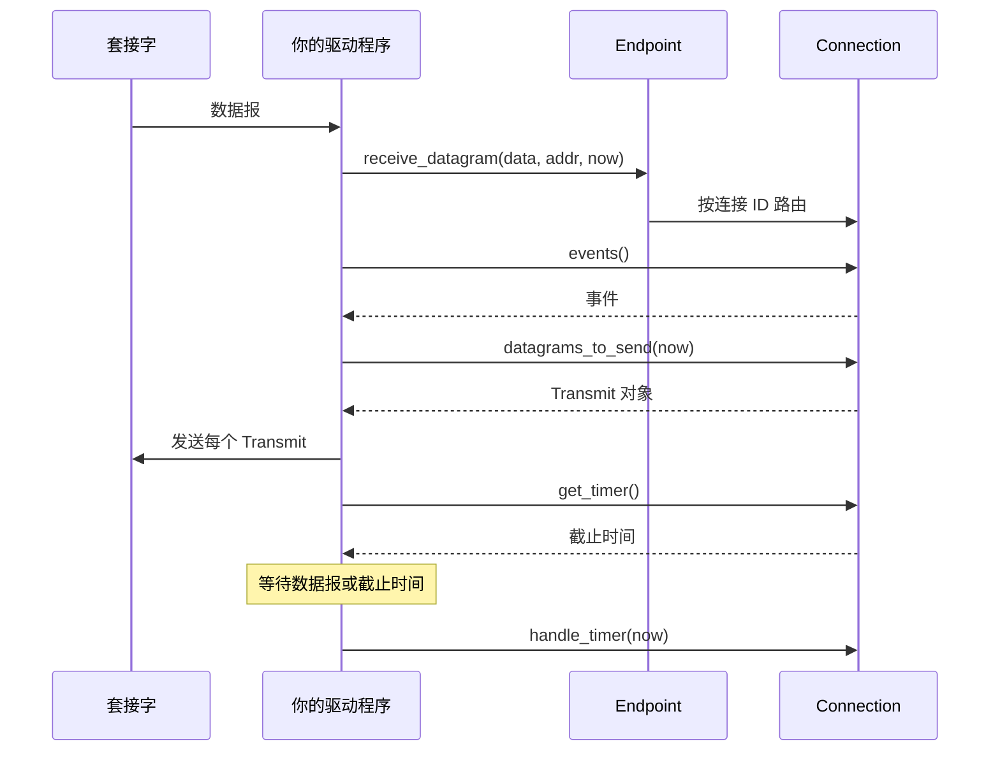

# 理解 sans-I/O 模型

学完本教程，你会得到一个小型驱动程序，由它承担 ngquic 留给你的程序的工作：为两个 `Endpoint` 传递数据报、读取事件、运行定时器。驱动程序使用虚拟时钟，时钟直接跳到下一个定时器，所以连接的建立、回显、关闭和状态释放转眼就能看完。

## 准备工作 {#before-you-start}

- 先完成[第一次握手](first-handshake.md)。本教程使用同一个 `quic-tour` 目录，并导入[获取测试证书](first-handshake.md#get-a-test-certificate)一节中的 `localhost_certs.py`。

## 运行驱动程序 {#run-the-driver}

把下面的程序保存到 `quic-tour` 中，命名为 `protocol_model.py`，与 `localhost_certs.py` 放在一起：

```python title="protocol_model.py"
--8<-- "examples/protocol_model.py"
```

运行：

```console
python protocol_model.py
```

输出如下：

```text
client HandshakeCompleted
client StreamsAvailable
server HandshakeCompleted
server HandshakeConfirmed
server StreamsAvailable
server StreamDataReceived
client HandshakeConfirmed
client NewTokenReceived
client SessionTicketReceived
client SessionTicketReceived
client StreamDataReceived
client StreamClosed
client ConnectionTerminated
server ConnectionTerminated
client CLOSED, server CLOSED 3 PTOs after close()
endpoints hold 0
```

程序会打印每个事件，包括许多它并不处理的事件。下一节介绍驱动程序用到的接口，之后三节分部分讲解驱动程序本身。代码都摘自 `protocol_model.py`，不需要再输入。

## 三种输入，三种输出 {#three-inputs-three-outputs}

进入 ngquic 的都是方法调用，从 ngquic 出来的都是返回值：

| 你的程序传入 | ngquic 返回 |
| --- | --- |
| 收到的 UDP 载荷：`Endpoint.receive_datagram(data, remote_addr, now)` | 待发送的载荷：`datagrams_to_send()` 返回的 `Transmit` 对象 |
| 定时器的到期时间：`handle_timer(now)` | 下一个截止时间：`get_timer()` |
| 应用的操作：`open_stream()`、`send_stream_data()`、`close()` | 发生了什么：`events()` |

凡是可能启动或运行定时器的调用都要传入 `now`：以秒为单位的单调时间，类型为 `float`，用哪个时钟由你的程序决定。ngquic 只比较你传入的值，所以这个示例可以让时钟从 `0.0` 开始，再手动推进。

驱动程序的一轮如下：



## 发送队列中的数据 {#send-what-is-queued}

```python
--8<-- "examples/protocol_model.py:network"
```

`flush()` 收集两类输出。`Endpoint.datagrams_to_send()` 返回不属于任何连接的无状态回复：Version Negotiation 包、Retry 包、拒绝连接的回复和无状态重置（stateless reset）。`Connection.datagrams_to_send(now)` 返回连接自己的数据包。每次输入之后都要调用这两个方法，因为任何输入都可能产生待发送的数据。

每个 `Transmit` 的 `remote_addr` 是目的地址，`local_addr` 是源地址。这条不丢包的模拟链路靠这两个地址找到接收方的 `Endpoint`，并告诉它数据报从哪里来。

`Endpoint.receive_datagram()` 的返回值有三种：接收该数据报的连接；代表新连接尝试的 `Incoming`；数据报被丢弃或已作无状态回复时返回 `None`。服务器对每个 `Incoming` 只做一次决定：`accept()`；`retry()`，要求客户端先证明自己的地址（[RFC 9000 第 8.1 节](https://www.rfc-editor.org/rfc/rfc9000#section-8.1)）；`refuse()`；或 `ignore()`。连接尝试被丢弃或需要地址验证时，`accept()` 可能返回 `None`，所以驱动程序要检查返回值。

`wait()` 向每个连接询问 `get_timer()`。返回 `None` 表示该连接不需要定时器；否则返回值就是必须调用 `handle_timer()` 的时刻，按你的时钟计算。真实的驱动程序会休眠到这个时刻，或者等到有数据报到达，以先发生者为准。这个驱动程序则直接把时钟拨到那一刻，所以示例瞬间就能跑完，每次运行的输出都相同。

## 处理事件 {#react-to-events}

```python
--8<-- "examples/protocol_model.py:run"
```

循环先调用 `flush()`，再取完每个连接的 `events()`，只有在没有数据报传递时才等待定时器。应用只处理三个事件：

- 客户端收到 `HandshakeCompleted`：打开一个流，发送 `b"ping"`。
- 服务器收到 `StreamDataReceived`：在同一个流上把数据发回。
- 客户端收到带 `end_stream=True` 的 `StreamDataReceived`：调用 `close()`。

其余事件只是提供信息，应用可以利用，也可以忽略。`HandshakeConfirmed` 表示握手已不可能再失败（[RFC 9001 第 4.1.2 节](https://www.rfc-editor.org/rfc/rfc9001#section-4.1.2)）。`StreamsAvailable` 表示对端还允许本端再打开多少个流。`NewTokenReceived` 和 `SessionTicketReceived` 分别带来一个令牌（token）和若干会话票据（session ticket），以后的连接把它们传给 `connect()`，就能跳过地址验证并恢复会话。

`close()` 调用后，下一次 `datagrams_to_send()` 会发出 CONNECTION_CLOSE。QUIC 在传输层没有优雅关闭，所以要先让你关心的流结束，就像这里的客户端等收完整个回复才关闭。

## 观察连接关闭 {#watch-the-connection-close}

```python
--8<-- "examples/protocol_model.py:after"
```

双方同时报告 `ConnectionTerminated`，但都还没有进入 `CLOSED`。主动关闭的客户端进入关闭期（closing period），对迟到的数据包回复 CONNECTION_CLOSE；收到关闭的服务器进入排空期（draining period），不再发送任何数据。两个时期都持续当前 PTO（探测超时）的三倍，这是 [RFC 9000 第 10.2 节](https://www.rfc-editor.org/rfc/rfc9000#section-10.2)规定的下限；ngquic 在你本来就在驱动的定时器上运行它们。因此双方要在 `close()` 之后过三个 PTO 才会到达 `ConnectionState.CLOSED`，`get_timer()` 也才返回 `None`。程序以 PTO 而不是毫秒为单位打印等待时间，因为 PTO 本身取决于 ngtcp2 的 RTT 估计和定时器设置。此后，`Endpoint.connections` 不再计入任何仍持有协议状态的连接。

!!! warning "警告"
    收到 `ConnectionTerminated` 之后，仍要继续调用 `handle_timer()`。如果驱动程序在这个事件出现时就丢弃连接，就会跳过关闭期或排空期，`Endpoint` 也会一直保留这个连接的状态。

## 职责划分 {#who-owns-what}

ngquic 借助 ngtcp2 和 AWS-LC 负责协议本身：TLS 握手、数据包保护、丢包恢复、拥塞控制、流量控制、路径验证和密钥更新。`Endpoint` 还负责按连接 ID 路由、Retry、地址验证令牌、版本协商和无状态重置。关闭期、排空期和所有定时器都以你传入的时钟为准。

凡是与系统打交道的部分都由你的程序负责：套接字、事件循环、DNS、证书的来源，以及应用层超时。同一时刻只能由一个线程驱动一个 `Endpoint` 及其连接。

## 下一步 {#next-steps}

- [在 UDP 上运行](udp.md)：用 `127.0.0.1` 上的 UDP 套接字和真实的单调时钟替换模拟链路与虚拟时钟。
- `Endpoint`、`Incoming` 和这里用到的连接方法见 [API 参考](../reference/connections.md)，输出中的每个事件见[事件参考](../reference/events.md)。
